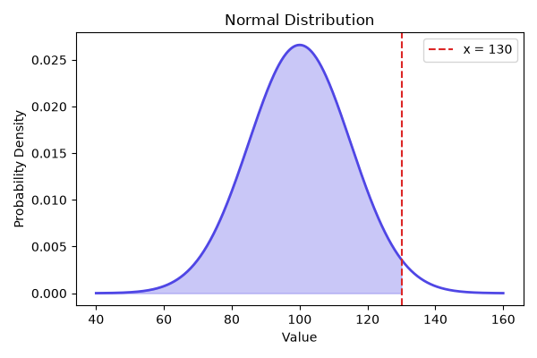

# 📊 GaussifyAPI

A small Flask API that answers a simple question: *given a mean, a standard deviation, and a target value, what's the probability of landing at or below that value on a Normal distribution?*

It calculates the answer with SciPy, draws the bell curve with Matplotlib, and keeps a history of every calculation in SQLite — so you can see not just the number, but the shape of the curve behind it.

---

## Why a Normal distribution API?

The Normal distribution shows up almost everywhere in statistics and machine learning, often quietly, in the background. Standardizing features before training a model, running a Gaussian Naive Bayes classifier, checking whether an A/B test result is actually significant — all of it leans on the same curve and the same probability calculation this API exposes. It's one of those ideas that's easy to skim past in a textbook, but a lot more intuitive once you can actually plug in numbers and watch the curve shift.

This project isn't trying to be a statistics library — it's a hands-on way to see that math in action: type in three numbers, get back a probability and a picture of what that probability actually looks like on the curve.

## 📸 Example



## How it's built

The project follows Flask's **Application Factory** pattern, split into two layers: `core`, which just does math, and `api`, which handles the web side of things.

```
GaussifyAPI/
├── core/               # The math — knows nothing about Flask or HTTP
│   ├── __init__.py
│   └── services.py     # Probability calculation + chart generation
│
├── api/                # The web layer
│   ├── __init__.py     # create_app()
│   ├── extensions.py   # SQLAlchemy instance
│   ├── models.py        # The Calculation table
│   └── routes.py        # The endpoints
│
├── requirements.txt
├── .env.example
└── run.py
```

`core` takes numbers, returns numbers and an image — it doesn't know a web server exists. That keeps it easy to test on its own, and it would keep working even if Flask were swapped for something else down the line. The `api` layer is what talks to SQLite through `models.py`, saving each result so the history sticks around between requests.

---

## Running it locally

```bash
git clone https://github.com/joaopinheiroc/GaussifyAPI.git
cd GaussifyAPI

python -m venv venv
source venv/bin/activate      # Windows: venv\Scripts\activate

pip install -r requirements.txt

cp .env.example .env
python -c "import secrets; print(secrets.token_hex(32))"
# paste the generated key into .env as SECRET_KEY

python run.py
```

The server starts at `http://127.0.0.1:5000`, and a SQLite database is created automatically the first time you run it.

---

## Endpoints

| Method | Endpoint | What it does |
|---|---|---|
| `POST` | `/api/calculations` | Calculates a probability, saves it, returns the result + chart |
| `GET` | `/api/calculations` | Lists past calculations |
| `GET` | `/api/calculations/<id>` | Returns one calculation, chart included |
| `DELETE` | `/api/calculations/<id>` | Deletes one from the history |

A quick example:

```bash
curl -X POST http://127.0.0.1:5000/api/calculations \
  -H "Content-Type: application/json" \
  -d '{"mean": 100, "std_dev": 15, "target_x": 130}'
```

```json
{
  "id": 1,
  "mean": 100.0,
  "std_dev": 15.0,
  "target_x": 130.0,
  "probability": 0.9772498680518208,
  "created_at": "2026-07-22T12:00:00+00:00",
  "chart_base64": "iVBORw0KGgoAAAANSUhEUgAA..."
}
```

Drop `chart_base64` into an `` tag and you'll see the curve.

---

## What it's built with

- **Flask** — the web framework
- **Flask-SQLAlchemy** — talks to the database
- **SciPy** — does the actual statistics (`norm.cdf`)
- **NumPy** — powers the number-crunching behind the chart
- **Matplotlib** — draws the curve
- **SQLite** — stores the history, no setup required
- **python-dotenv** — keeps secrets out of the code

---

## License

MIT.